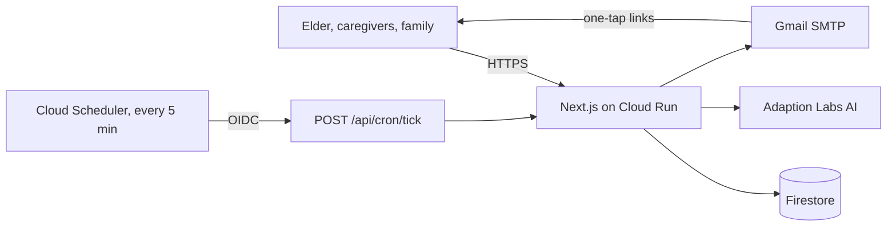

# KinKeep

**The care circle the elder runs, not one that is run about them.**

**Live app:** https://kinkeep-692923269273.asia-south1.run.app (choose **Try the demo**)

[](https://github.com/SKrafiqh/kinkeep/actions/workflows/ci.yml)

## The problem

Older adults on several medicines miss doses, double up, or lose track after a prescription
change. Families hear late, usually by phone, from one overloaded caregiver. Most reminder
apps treat the elder as the person being watched, so they lose trust and stop using it.

## What makes it different

- **The elder is in charge.** They choose each member's role and three alert switches. Every
  change to their care appears in a plain-words feed: "Priya changed Metformin from 500 mg to
  1000 mg".
- **Escalate, do not spam.** A dose email goes to the elder 15 minutes before. Unconfirmed at
  30 minutes: a gentle nudge to the elder only. Unconfirmed at 60: marked missed, and only the
  members the elder opted in are told.
- **One tap, no login.** Each dose email has a signed, single-use, expiring "I took them" link.
  Opening the link changes nothing (mail scanners open links); the button does.
- **A brief for every doctor visit.** Adherence since the last visit, missed-dose patterns,
  medicine changes and questions to ask, prepared by AI and editable by a person. If the AI is
  down, the same brief is built from the records without it.

## Two-minute tour

1. Open the app and choose **Try the demo**. You are signed in as the elder, Mr Rao, with a
   month of history and a dose due in a few minutes.
2. **Today**: tap **Taken** on the next slot.
3. Enter your own email under **See a reminder email**, open it, tap **I took them**, confirm.
4. **Circle**: 7 and 30-day adherence, the day strip, the next visit, what changed.
5. **Members**: turn off missed-dose alerts for Arjun. The elder decides.
6. **Appointments** → open a visit → **Prepare the visit brief** → print.
7. Sign out and join as Priya with the code and passcode in the demo banner: the caregiver view.

## Features, in the brief's own words

| The brief asks for | KinKeep |
| --- | --- |
| Manage daily medications, appointments, routines | Medicines with times and days; appointments; Today view |
| Shared ecosystem with secure passcode access | Circle code + personal 6-digit passcode; elder, caregiver and family roles |
| Track adherence | Taken, skipped, missed and taken-late per dose; 7 and 30-day adherence |
| Email reminders: upcoming, missed, appointments | 15-minute reminder, 30-minute nudge, 60-minute missed alert, 24 h and 2 h visit reminders, Sunday summary |
| Keep family informed | Opt-in alerts per member and the "what changed" feed |

## How it works



**One reminder, end to end.** Adding a medicine creates its dose events for the next 36 hours,
with ids built from the medicine, date and time, so creating them twice changes nothing. Every
5 minutes the scheduler calls the tick, which reads only events whose `nextActionAt` is due.
For each slot it moves the stage inside a transaction and only then sends one email per
recipient, so two overlapping ticks can never send the same stage twice. A failed send is
retried after 5 minutes, up to three times per stage. The stage machine itself is pure code in
`src/domain/escalation.ts`.

## Code map

| Folder | Holds |
| --- | --- |
| `src/domain/` | Pure logic, no I/O: time zones, schedules, escalation, adherence, permissions |
| `src/server/` | Repositories, services, reminder engine, auth, email, AI adapter |
| `src/app/` | Pages and thin API route handlers (Zod in, one service call, JSON out) |
| `src/components/` | Presentational React components |
| `tests/unit`, `tests/api` | Vitest, against in-memory fakes, no network |

Why it is built this way: [architecture decision records](docs/adr/README.md).

## Google services

| Service | Where |
| --- | --- |
| Cloud Run | `Dockerfile`, `next.config.ts` (standalone output) |
| Firestore | `src/server/repos/firestoreStore.ts`, `firestore.rules`, `firestore.indexes.json` |
| Cloud Scheduler (OIDC) | `src/server/auth/cron.ts`, `src/server/auth/googleOidc.ts` |
| Secret Manager | secrets injected at deploy, see `docs/SETUP.md` |
| Cloud Build, Cloud Logging | `gcloud run deploy --source`, structured logs in `src/lib/logger.ts` |
| Gmail | `src/server/email/gmailSender.ts` |
| Google Fonts | Atkinson Hyperlegible Next via `next/font`, `src/app/layout.tsx` |

## Run it

```bash
cp .env.example .env.local     # DATA_STORE=memory and EMAIL_PROVIDER=console need no accounts
npm install
npm run dev
```

```bash
npm run verify                 # lint, typecheck, unit and API tests, production build
```

Trigger the reminder engine locally:

```bash
curl -X POST http://localhost:3000/api/cron/tick -H "x-cron-secret: $CRON_SECRET"
```

Deploy to Cloud Run: `docs/SETUP.md`.

## Security notes

- Passcodes: HMAC with a server pepper, then scrypt with a per-member salt, compared in constant
  time. Five wrong tries lock that member for 15 minutes, counted in a transaction so parallel
  guesses cannot outrun the lock.
- Sessions: signed HttpOnly, SameSite=Lax cookie (Secure on HTTPS), 12 hours. Membership and
  role are re-read on every request, so removing someone takes effect immediately.
- Every query starts from the circle in the session. Mutations check the `Origin` header.
- A strict Content-Security-Policy with a per-request nonce, plus HSTS and the usual headers.
- AI: records are passed as delimited data, never as instructions; the reply must match a Zod
  schema or it is discarded. No dosing advice; every brief carries the "not medical advice" line.
- Abuse limits: per-address rate limits, plus daily caps in the database for test emails, demo
  circles and AI calls, and size caps per circle.

**Known limits, stated plainly.** A 6-digit passcode is a convenience suited to the brief, not
strong authentication; the lockout and the pepper are the mitigations. Because the lockout is
per member, someone who knows a circle code can lock a member out for 15 minutes; one-tap email
links keep working. Rate limits are per instance. Gmail consumer accounts send about 500
emails a day. This is not a medical device.

## Accessibility

Atkinson Hyperlegible Next type at 18 px and above, 48 px targets (56 px on Today), status shown by
icon, word and colour together, visible focus rings, a skip link, labelled fields with linked
errors, a polite live region, and `prefers-reduced-motion` respected. Target: WCAG 2.2 AA, with
AAA contrast on Today.
