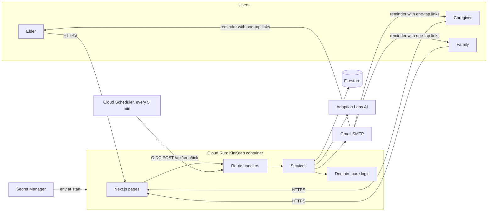

# KinKeep — Architecture

## 1. Stack and why

| Layer | Choice | Reason |
| --- | --- | --- |
| App | Next.js (App Router) + TypeScript strict | UI and API in one deployable unit; one container, one URL |
| Hosting | Cloud Run | Required for the top-10 check; scales to zero and out automatically |
| Data | Firestore, Native mode | Serverless, no connection pool to manage, free daily quota |
| Scheduler | Cloud Scheduler → `POST /api/cron/tick` | Managed cron; one job drives every reminder |
| AI | Adaption Labs Responses API via `fetch` | Visit brief, prescription scan, summaries |
| Email | Gmail SMTP via Nodemailer | Sends to any inbox without owning a domain |
| Secrets | Secret Manager | Nothing sensitive in the repo or the image |
| Build | Cloud Build (`gcloud run deploy --source .`) | No local Docker needed |
| Logs | Cloud Logging, structured JSON on stdout | No agent or SDK needed |
| UI | Tailwind CSS, Atkinson Hyperlegible (Google Fonts) | Typeface designed for low-vision readers |
| Quality | Zod, ESLint, Vitest, Playwright + axe, GitHub Actions | Validation, lint, tests, accessibility gate, CI |

Google services in use: Cloud Run, Firestore, Cloud Scheduler, Secret Manager,
Cloud Build, Cloud Logging, Gmail, Google Fonts.

## 2. System diagram



## 3. Repository layout

```
.
├── CLAUDE.md
├── README.md
├── Dockerfile
├── .dockerignore  .gitignore  .env.example
├── firebase.json                 # points at the two Firestore files below
├── firestore.indexes.json
├── firestore.rules               # deny all client access
├── docs/
├── .github/workflows/ci.yml      # lint, typecheck, test, build
├── src/
│   ├── app/                      # pages and /api route handlers only
│   ├── components/               # presentational React components
│   ├── domain/                   # pure logic, no I/O
│   │   ├── schedule.ts           # expand a medicine into dose instants
│   │   ├── escalation.ts         # dose stage machine
│   │   ├── adherence.ts          # percentages, streaks, patterns
│   │   ├── permissions.ts        # role → allowed actions
│   │   └── time.ts               # all time-zone conversion
│   ├── server/
│   │   ├── repos/                # Firestore repositories + interfaces
│   │   ├── services/             # use cases: circles, meds, doses, appts, reminders
│   │   ├── email/                # EmailSender, gmail + console adapters, templates
│   │   ├── ai/                   # AiClient, prompts, output schemas
│   │   ├── auth/                 # passcode, session, action tokens, cron auth
│   │   └── config.ts             # env parsed once with Zod
│   └── lib/                      # shared schemas, errors, logger, constants
└── tests/
    ├── unit/                     # domain
    ├── api/                      # services and routes with in-memory fakes
    └── e2e/                      # Playwright + axe
```

## 4. Data model (Firestore)

All paths are under one circle, so every read is scoped by `circleId`.

```
circles/{circleId}
  elderName, timeZone (IANA), code (unique, upper-case), createdAt
  settings: { leadMin: 15, nudgeMin: 30, escalateMin: 60 }
  remindersTo?                       # member who gets the elder's own reminders; unset = the elder
  nextSummaryAt?                     # next Sunday 18:00 local, for the weekly summary
  demoPasscode?                      # demo circles only, shown in the demo banner

circles/{circleId}/quota/{name}       # daily caps: { day, count } for 'ai' and 'testEmail'

circles/{circleId}/members/{memberId}
  name, email?, role: 'elder' | 'caregiver' | 'family'
  passcodeHash, passcodeSalt, mustChangePasscode
  alerts: { missedDose, appointments, weeklySummary }
  failedAttempts, lockedUntil?, removedAt?

circles/{circleId}/medications/{medId}
  name, strength, form, instructions
  times: ['08:00', '20:00'], daysOfWeek: [0..6]
  startDate, endDate?, active
  materialisedUntil?                 # dose events exist up to here; the tick tops this up
  createdBy, updatedBy, updatedAt

circles/{circleId}/doseEvents/{medId_YYYYMMDD_HHmm}     # deterministic id
  medId, medName, strength           # denormalised for email and Today view
  dueAt (UTC), slotKey               # slotKey = circleId + dueAt
  status: 'scheduled' | 'reminded' | 'nudged' | 'missed' | 'taken' | 'skipped'
  nextActionAt?                      # when the engine must look again; unset when finished
  actedBy?, actedAt?, late?
  attempts, lastError?

circles/{circleId}/appointments/{apptId}
  doctor, speciality, place, at (UTC), notes
  nextReminderAt?, remindersSent: { h24, h2 }
  brief?: { content: { summary, patterns[], changes[], questions[] }, generatedAt,
            source: 'ai' | 'fallback', editedBy? }

circles/{circleId}/activity/{activityId}
  actorId, actorName, action, targetType, targetId, summary, at

usedTokens/{jti}                     # one-tap token replay guard; expireAt has a TTL policy
quota/{name}                         # app-wide daily caps: 'testEmail', 'demo'
```

Indexes (`firestore.indexes.json`), collection-group scope:

- `doseEvents.nextActionAt` ascending
- `appointments.nextReminderAt` ascending
- `medications.materialisedUntil` ascending
- `circles.code`, `circles.nextSummaryAt` single-field (default)

`usedTokens.expireAt` carries a TTL policy, so used one-tap records delete themselves.

`firestore.rules` denies every client read and write. Only the server, through the Admin
SDK and the Cloud Run service account, touches the database.

## 5. Routes

Pages

| Path | Purpose |
| --- | --- |
| `/` | Landing: create a circle, join a circle, try the demo |
| `/join` | Circle code → pick name → passcode |
| `/today` | Elder-first view of today's doses |
| `/circle` | Dashboard: adherence, upcoming appointments, what changed |
| `/medications`, `/medications/[id]` | List, add, edit |
| `/appointments`, `/appointments/[id]` | List, add, edit, visit brief |
| `/members` | Elder only: roles and alert switches |
| `/act/[token]` | Confirm page for one-tap email actions |

API (all JSON, all validated with Zod)

| Method and path | Auth | Purpose |
| --- | --- | --- |
| `POST /api/circles` | none, rate limited | Create a circle |
| `POST /api/circles/demo` | none, rate limited | Seed a demo circle |
| `POST /api/session` / `DELETE /api/session` | passcode / session | Sign in, sign out |
| `GET /api/circles/lookup?code=` | none, rate limited | Member names for the join screen |
| `GET, POST /api/medications` · `PATCH, DELETE /api/medications/[id]` | session + role | Medicines |
| `GET /api/doses?date=` · `POST /api/doses/[id]/act` | session + role | Today view, mark taken or skipped |
| `GET, POST /api/appointments` · `PATCH, DELETE /api/appointments/[id]` | session + role | Appointments |
| `POST /api/appointments/[id]/brief` | session | Generate the visit brief |
| `GET, POST /api/members` · `PATCH, DELETE /api/members/[id]` | session, elder | Members, roles, alerts |
| `GET /api/activity` | session | What changed |
| `POST /api/act` | signed action token | One-tap action from email |
| `POST /api/test-reminder` | session, rate limited | Send one sample email |
| `POST /api/cron/tick` | Scheduler OIDC | Reminder engine |
| `GET /api/health` | none | Liveness for Cloud Run and the submission check |

## 6. Access and sessions

1. Join: circle code → `lookup` returns member display names only → member picks their
   name and enters a 6-digit passcode.
2. Verify: `scrypt(HMAC_SHA256(pepper, passcode), salt)` compared with
   `crypto.timingSafeEqual`. `PASSCODE_PEPPER` lives in Secret Manager, so a database
   leak alone is not enough to brute-force six digits.
3. Lockout: `failedAttempts` and `lockedUntil` are updated in a transaction. Five
   failures lock the member for 15 minutes.
4. Session: a signed cookie (HS256, `SESSION_SECRET`), HttpOnly, Secure, SameSite=Lax,
   12 hours, carrying `circleId`, `memberId`, `role`.
5. Every mutating request re-reads the member document: a removed member or changed role
   takes effect on the next request.
6. Permissions are one pure table in `domain/permissions.ts`, tested exhaustively.

Known limit, stated honestly in the README: a 6-digit passcode is a convenience factor
suited to the brief, not strong authentication. Lockout and the pepper are the mitigations.

## 7. Reminder engine

Cloud Scheduler calls `/api/cron/tick` every 5 minutes. One tick does four things:

1. **Materialise.** For every active medicine, make sure dose events exist for the next
   36 hours. Ids are deterministic (`medId_YYYYMMDD_HHmm` in the circle's time zone), so
   re-running creates nothing new. New events get `nextActionAt = dueAt - leadMin`.
2. **Advance doses.** Query the `doseEvents` collection group where
   `nextActionAt <= now`, ordered, limited to a page. Group by `slotKey`. For each event,
   inside a transaction: re-read, compute the next stage with `domain/escalation.ts`,
   write the new `status` and `nextActionAt`. Only after the commit, send one email per
   recipient per slot.
3. **Appointment reminders.** Same pattern on `appointments.nextReminderAt` for the
   24-hour and 2-hour reminders.
4. **Weekly summary** (P1). Sunday evening in each circle's time zone.

Stage machine

| From | When | Action | To | Next look |
| --- | --- | --- | --- | --- |
| scheduled | dueAt − 15 min | Email elder: upcoming slot | reminded | dueAt + 30 min |
| reminded | dueAt + 30 min | Email elder: gentle nudge | nudged | dueAt + 60 min |
| nudged | dueAt + 60 min | Email opted-in members: missed | missed | none |
| any open stage | user acts | none | taken or skipped | none |
| missed | user marks taken | none | taken, `late: true` | none |

Reliability

- The claim (stage write) happens before the send, so two overlapping ticks cannot send
  the same stage twice.
- A failed send records `lastError`, increments `attempts`, and sets `nextActionAt` five
  minutes ahead, up to three attempts.
- A tick has a time budget; it stops cleanly and the next tick continues.
- Editing a medicine deletes its future open events and re-materialises them. Past
  events are never rewritten, so adherence history stays true.
- Daylight-saving and time-zone logic lives in `domain/time.ts` using `Intl`, with tests
  for a DST zone as well as Asia/Kolkata.

One-tap links

- Token: HMAC-SHA256 over `{ jti, circleId, slotKey, memberId, action, exp }` with
  `ACTION_TOKEN_SECRET`. Expires 24 hours after the dose time.
- `GET /act/[token]` renders a confirm page and changes nothing, because mail scanners
  and link previews fetch URLs.
- `POST /api/act` verifies the token, records `jti` in `usedTokens`, and applies the
  action to every dose in the slot.

## 8. Email

`EmailSender` interface with two adapters, selected by `EMAIL_PROVIDER`:

- `gmail`: Nodemailer over `smtp.gmail.com:465` using a Google account app password.
- `console`: logs the rendered email; used in local dev and tests.

Templates are plain functions returning `{ subject, html, text }`: upcoming slot, nudge,
missed alert, appointment reminder, test reminder, weekly summary. Every email has a text
part, a single primary action, 18 px or larger type, and no remote images.

## 9. AI

`AiClient` interface; the adapter calls the Adaption Labs Responses API
(`POST /api/v1/responses`) with plain `fetch`. The model id comes from `AI_MODEL` so it can be
changed without a code change. That API documents no JSON mode, so the JSON Schema is stated
in the instructions, the JSON object is cut out of the reply, and Zod rejects anything else.

| Feature | Input | Output | Guardrails |
| --- | --- | --- | --- |
| Visit brief | Adherence stats, missed patterns, medicine changes, appointment notes | JSON: summary, patterns[], changes[], questions[] | No advice; Zod-validated; non-AI fallback from the same data |
| Add by photo (P1) | One image or pasted text | JSON: medicines[] with name, strength, times, days, confidence | Draft only; each line confirmed by a person; image not stored |
| Weekly summary (P1) | One week of stats | Two or three sentences | Numbers come from code, not from the model |

Rules: system instruction fixes the role and the refusals; user content is passed as
data in a delimited block; responses are requested as JSON against a schema and parsed
with Zod; timeouts and one retry; a per-circle daily cap; results cached on the
appointment document.

## 10. Security checklist

- Input validation with Zod on every route; unknown fields rejected.
- AuthN and AuthZ as in section 6; every repository method takes `circleId`.
- CSRF: SameSite=Lax cookie plus `Origin` check on mutations.
- Headers: Content-Security-Policy, Strict-Transport-Security, X-Content-Type-Options,
  Referrer-Policy, Permissions-Policy, frame-ancestors none.
- Rate limits: member lockout in Firestore; per-IP token bucket in memory for public
  routes (best effort across instances; stated as such).
- Cron route verifies the Scheduler OIDC token's signature, audience and service account.
- Secrets from Secret Manager; config parsed once and frozen; the app refuses to start
  with a missing secret in production.
- Logs carry ids, never passcodes, tokens, full emails or medicine names.
- Uploads (P1): type and size checked, processed in memory, never written to disk.
- Dependencies: lockfile committed, `npm audit` in CI.
- Container runs as a non-root user.

## 11. Scalability

- The container is stateless; Cloud Run adds instances under load and drops to zero when
  idle. Session state is in the cookie, data in Firestore.
- Firestore scales without schema or pool changes. All hot queries are by document id or
  by one indexed field.
- The engine reads only events whose `nextActionAt` is due, so cost follows the number of
  actions due, not the number of circles or medicines.
- Deterministic ids and transactional claims make ticks safe to retry and to overlap.
- Growth path, documented not built: replace the in-tick send loop with one Cloud Tasks
  task per slot; shard the tick by circle hash; move rate limits to a shared store.

## 12. Efficiency

- Server components for reads; client JavaScript only where there is interaction.
- No chart library: adherence bars are CSS.
- Dose events carry the medicine name and strength, so the Today view is one query.
- The AI model is called only on an explicit user action and the result is cached.
- Multi-stage Docker build with Next.js standalone output for a small image and a fast
  cold start.

## 13. Testing

| Level | Tool | Covers |
| --- | --- | --- |
| Unit | Vitest | Schedule expansion, time zones, stage machine, adherence, permissions, tokens, passcode |
| API | Vitest + in-memory fakes | Each service and route: happy path, validation, authorisation, lockout, idempotent tick |
| E2E | Playwright | Create circle → add medicine → mark taken → dashboard updates |
| Accessibility | axe via Playwright | Zero violations on every page |
| CI | GitHub Actions | lint, typecheck, unit and API tests, build on every push |

Targets: every `domain/` function tested; every route has at least one success, one
validation-failure and one authorisation-failure test.
